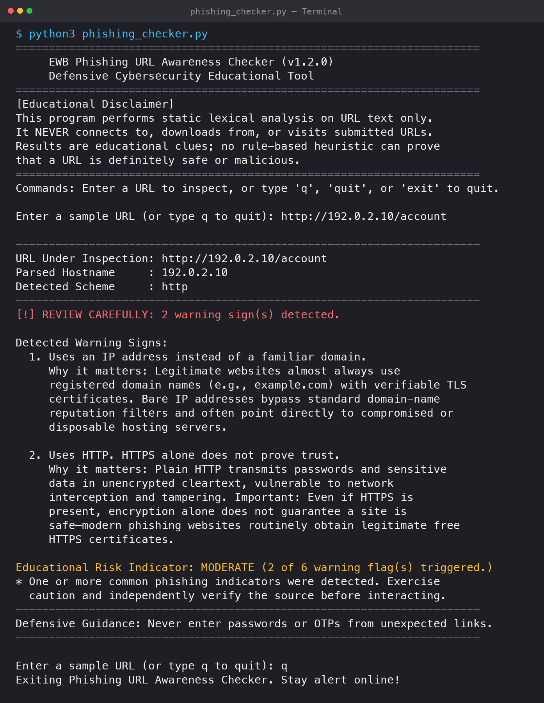
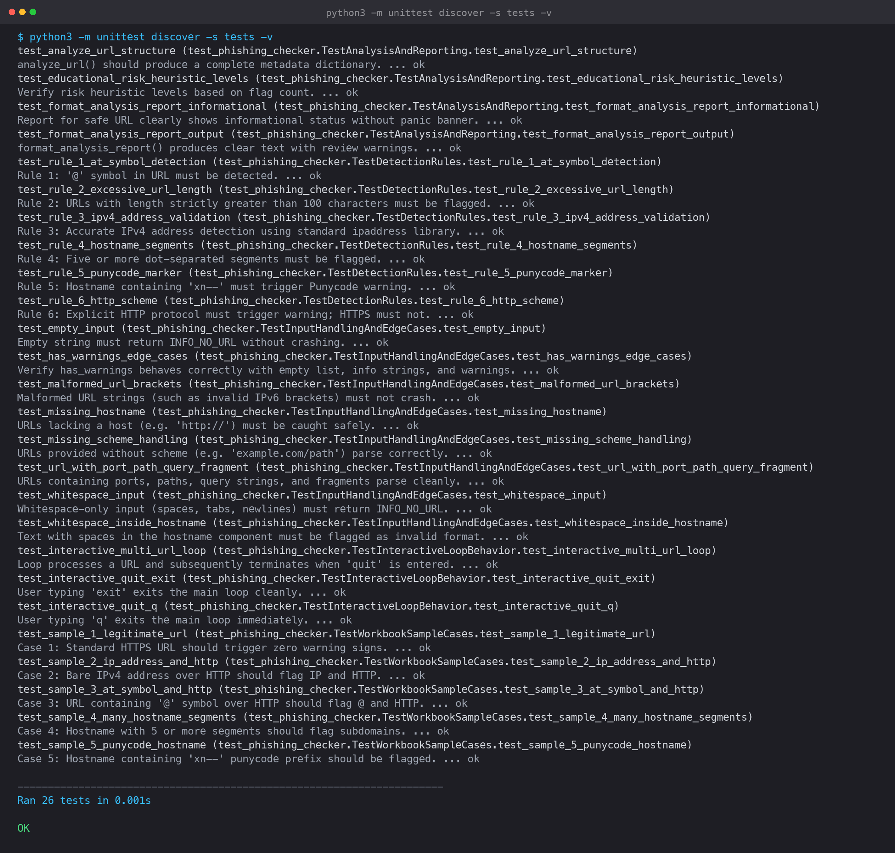

# Phishing URL Awareness Checker

A lightweight, defensive cybersecurity educational tool that performs static lexical analysis on URLs to identify common phishing indicators without making network requests.


-brightgreen.svg)


---

## Table of Contents
1. [Project Overview](#project-overview)
2. [Problem Statement](#problem-statement)
3. [Objectives](#objectives)
4. [Key Features](#key-features)
5. [Technology Stack](#technology-stack)
6. [System Requirements](#system-requirements)
7. [Project Folder Structure](#project-folder-structure)
8. [Installation and Execution](#installation-and-execution)
9. [Usage Guide](#usage-guide)
10. [Example Execution and Output](#example-execution-and-output)
11. [Detection Rules & Technical Explanations](#detection-rules--technical-explanations)
12. [Educational Risk Heuristic](#educational-risk-heuristic)
13. [Implemented Improvements](#implemented-improvements)
14. [Testing Procedure and Genuine Results](#testing-procedure-and-genuine-results)
15. [Screenshots](#screenshots)
16. [Security, Privacy, and Limitations](#security-privacy-and-limitations)
17. [Cybersecurity Ethics & Safe Usage](#cybersecurity-ethics--safe-usage)
18. [Author Information](#author-information)
19. [GitHub Publication Instructions](#github-publication-instructions)

---

## Project Overview

Phishing remains one of the primary entry vectors for social engineering attacks, credential theft, and malware distribution. Deceptive links in emails, SMS (smishing), and instant messages often trick users into surrendering sensitive personal information, enterprise credentials, or one-time passwords (OTPs).

The **Phishing URL Awareness Checker** is an educational utility designed for students, cybersecurity beginners, and security awareness programs. It parses submitted URL text and inspects it against **six fundamental heuristic indicators** frequently observed in deceptive links.

> **Defensive Principle:** The program is strictly passive. It performs static text analysis only; it **never** makes network connections, queries external DNS, opens sockets, or sends data to third-party reputation APIs.

---

## Problem Statement

Users often struggle to determine whether a suspicious link requires scrutiny before clicking. Attackers take advantage of human cognitive biases and user-interface limitations (such as narrow mobile browser address bars) by utilizing URL obfuscation techniques:
- Masking destinations using the `@` credential authority delimiter.
- Substituting raw numeric IP addresses for established domain names.
- Registering lookalike Internationalized Domain Names (IDNs) via Punycode homograph attacks.
- Stacking numerous subdomains to mimic trusted brand names.
- Employing unencrypted HTTP channels to transmit sensitive data.

An accessible, transparent, and explainable tool is needed to help beginners break down URL anatomy, identify suspicious structural patterns, and understand the technical rationale behind each warning.

---

## Objectives

1. **Demonstrate URL Anatomy:** Help learners understand protocol schemes, hostnames, subdomains, ports, paths, query strings, and fragments.
2. **Implement Six Core Heuristics:** Reliably detect `@` symbols, excessive length (>100 characters), IPv4 hostnames, 5+ hostname segments, Punycode markers (`xn--`), and HTTP schemes.
3. **Ensure Zero Dependency Friction:** Build the entire project using Python's standard library so it runs cross-platform without third-party package installations.
4. **Separate Logic from Presentation:** Isolate detection functions (`inspect_url()`, `analyze_url()`) from terminal interface rendering (`format_analysis_report()`, `main()`) to facilitate automated testing.
5. **Provide Educational Context:** Accompany every flagged warning with an explanation of *why* the pattern is dangerous, avoiding misleading guarantees of safety.

---

## Key Features

- **Multi-URL Inspection Loop:** Check multiple URLs in a single terminal session without restarting the program.
- **Robust URL Normalization:** Safely parses URLs whether submitted with full schemes (`https://`), protocol-relative prefixes (`//`), or bare domains (`example.com`), without corrupting scheme semantics.
- **Strict IPv4 Validation:** Employs Python's standard `ipaddress` library to validate octet ranges (0–255) rather than relying on loose regex patterns that falsely match out-of-bounds numbers like `999.999.999.999`.
- **Exception-Safe Architecture:** Handles empty strings, whitespace, malformed IPv6 brackets, and missing hostnames cleanly without crashing.
- **Numbered Warning Breakdowns:** Categorizes detections clearly with structured explanations explaining why each pattern matters.
- **Educational Risk Indicator:** Computes a transparent heuristic score (LOW, MODERATE, ELEVATED) accompanied by an explicit reminder that rule-based checks do not prove safety.
- **Submission-Ready Automated Tests:** Includes a 26-test suite using Python's built-in `unittest` framework, validating all workbook cases and edge scenarios.

---

## Technology Stack

- **Language:** Python 3.10+ (tested on Python 3.13)
- **Standard Library Modules:**
  - `urllib.parse`: RFC 3986 URL parsing and component decomposition.
  - `ipaddress`: Strict IPv4 address validation.
  - `typing`: Type annotations (`str`, `dict`, `list`, `tuple`, `Any`).
  - `unittest`: Automated unit testing and assertions.
  - `unittest.mock`: CLI input/output simulation.
- **Third-Party Dependencies:** None (`requirements.txt` is zero-dependency).

---

## System Requirements

- **Operating System:** Windows 10/11, macOS 12+ (Intel / Apple Silicon), or modern Linux distributions (Ubuntu, Fedora, Debian).
- **Python:** Python 3.10, 3.11, 3.12, or 3.13 installed and added to your system `PATH`.
- **Terminal:** Any standard console (Command Prompt, PowerShell, macOS Terminal, iTerm2, bash, zsh).

---

## Project Folder Structure

```text
phishing-url-awareness/
├── phishing_checker.py          # Main application and core detection logic
├── README.md                    # Project documentation, guides, and specifications
├── requirements.txt             # Dependency specification (Standard library only)
├── tests/
│   ├── test_samples.md          # Workbook sample verification table and test logs
│   └── test_phishing_checker.py # 26-test automated unittest suite
└── screenshots/
    ├── sample_run.png           # Terminal evidence showing interactive analysis
    └── test_results.png         # Terminal evidence showing passing unit tests
```

---

## Installation and Execution

### 1. Clone or Download the Repository

```bash
git clone https://github.com/iamanaypatel/phishing-url-awareness.git
cd phishing-url-awareness
```

### 2. Verify Python Installation

Windows:
```cmd
python --version
```

macOS / Linux:
```bash
python3 --version
```
*(Ensure Python 3.10 or higher is displayed.)*

### 3. Run the Application

Windows:
```cmd
python phishing_checker.py
```

macOS / Linux:
```bash
python3 phishing_checker.py
```

### 4. Run the Automated Test Suite

Windows:
```cmd
python -m unittest discover -s tests -v
```

macOS / Linux:
```bash
python3 -m unittest discover -s tests -v
```

---

## Usage Guide

1. **Launch the checker:** Execute `python3 phishing_checker.py` (or `python phishing_checker.py` on Windows).
2. **Review the educational disclaimer:** Read the opening banner outlining the tool's passive text analysis approach.
3. **Submit a URL:** Type or paste a URL at the prompt:
   ```text
   Enter a sample URL (or type q to quit): http://192.0.2.10/account
   ```
4. **Inspect the results:**
   - If warnings are found, review the **`[!] REVIEW CAREFULLY`** banner, the count of warnings, and the detailed "Why it matters" explanations.
   - If no warnings are found, note the **`[i] Informational Result`** advising continued vigilance.
5. **Check subsequent URLs:** The prompt returns automatically for another check.
6. **Exit cleanly:** Type `q`, `quit`, or `exit` (or press `Ctrl+C`).

---

## Example Execution and Output

### Example 1: Suspicious URL (IP Address + Insecure HTTP)

```text
======================================================================
     EWB Phishing URL Awareness Checker (v1.2.0)
     Defensive Cybersecurity Educational Tool
======================================================================
[Educational Disclaimer]
This program performs static lexical analysis on URL text only.
It NEVER connects to, downloads from, or visits submitted URLs.
Results are educational clues; no rule-based heuristic can prove
that a URL is definitely safe or malicious.
======================================================================
Commands: Enter a URL to inspect, or type 'q', 'quit', or 'exit' to quit.

Enter a sample URL (or type q to quit): http://192.0.2.10/account

----------------------------------------------------------------------
URL Under Inspection: http://192.0.2.10/account
Parsed Hostname     : 192.0.2.10
Detected Scheme     : http
----------------------------------------------------------------------
[!] REVIEW CAREFULLY: 2 warning sign(s) detected.

Detected Warning Signs:
  1. Uses an IP address instead of a familiar domain.
     Why it matters: Legitimate websites almost always use
     registered domain names (e.g., example.com) with verifiable TLS
     certificates. Bare IP addresses bypass standard domain-name
     reputation filters and often point directly to compromised or
     disposable hosting servers.

  2. Uses HTTP. HTTPS alone does not prove trust.
     Why it matters: Plain HTTP transmits passwords and sensitive
     data in unencrypted cleartext, vulnerable to network
     interception and tampering. Important: Even if HTTPS is
     present, encryption alone does not guarantee a site is
     safe—modern phishing websites routinely obtain legitimate free
     HTTPS certificates.

Educational Risk Indicator: MODERATE (2 of 6 warning flag(s) triggered.)
* One or more common phishing indicators were detected. Exercise
  caution and independently verify the source before interacting.
----------------------------------------------------------------------
Defensive Guidance: Never enter passwords or OTPs from unexpected links.
----------------------------------------------------------------------
```

### Example 2: Legitimate Example URL (Zero Warnings)

```text
Enter a sample URL (or type q to quit): https://www.example.com/login

----------------------------------------------------------------------
URL Under Inspection: https://www.example.com/login
Parsed Hostname     : www.example.com
Detected Scheme     : https
----------------------------------------------------------------------
[i] Informational Result:
  - No listed warning signs found. This does NOT prove safety.

Educational Risk Indicator: LOW (0 of 6 warning flags triggered.)
* No listed rule flags triggered. However, absence of flags does
  NOT prove a link is safe. Attackers frequently register fresh domains
  and obtain valid HTTPS certificates.
----------------------------------------------------------------------
Defensive Guidance: Never enter passwords or OTPs from unexpected links.
----------------------------------------------------------------------
```

---

## Detection Rules & Technical Explanations

| # | Detection Rule | Target Pattern | Why It Matters (Security Threat & Exploit Mechanics) |
|---|---|---|---|
| **1** | **`@` Symbol Detection** | `@` character present in URL | Under RFC 3986, characters preceding an `@` symbol in the authority block represent user credentials (`user:pass@host`), not the destination domain. Browsers ignore everything prior to `@` when establishing server connections. Attackers exploit this to craft deceptive links like `http://trusted-bank.com@evil-site.invalid`, fooling victims into believing they are visiting the trusted brand. |
| **2** | **URL Length > 100 Characters** | Length strictly exceeds 100 chars | Phishers construct unusually long URLs to embed encoded redirect payloads, hide malicious subdomains, or push the true destination domain off-screen on mobile devices and email clients where the address bar truncates long text. |
| **3** | **IPv4 Hostname** | Host is a valid dotted-decimal IPv4 address | Legitimate corporate services use registered domain names bound to public DNS records and authenticated SSL certificates. Direct IP hostnames bypass domain reputation lookups and frequently point to ephemeral, unauthenticated servers. |
| **4** | **Excessive Hostname Segments** | 5 or more dot-separated segments | Attackers employ "subdomain stacking" (e.g., `login.company.com.account.verify.evilhost.com`). Non-technical users notice the trusted brand name on the left side of the address and fail to realize the actual registered domain resides on the far right. |
| **5** | **Punycode Marker (`xn--`)** | Host contains the `xn--` prefix | Punycode translates non-ASCII Internationalized Domain Names (IDNs) into ASCII. In **homograph attacks**, adversaries substitute Cyrillic or Greek characters that look identical to Latin letters (e.g., Cyrillic 'а' U+0430 for Latin 'a' U+0061) to impersonate trusted brands. |
| **6** | **HTTP Scheme** | Scheme equals `http` | HTTP traffic is unencrypted and susceptible to Man-In-The-Middle (MITM) snooping and injection. *Critical educational note:* While HTTP is insecure, HTTPS alone does not guarantee legitimacy—phishing websites routinely use HTTPS certificates. |

---

## Educational Risk Heuristic

To assist students in comparing URL risk indicators, the tool computes a transparent rule-based heuristic:

| Heuristic Tier | Flags Triggered | Pedagogical Interpretation |
|---|:---:|---|
| **LOW** | 0 / 6 | No listed warning signs found. The URL does not exhibit obvious structural red flags, but users must remember that new phishing domains can appear clean. |
| **MODERATE** | 1 – 2 / 6 | One or two warning flags triggered (e.g., HTTP scheme or long URL). Requires user caution and independent verification of the link source. |
| **ELEVATED** | 3+ / 6 | Multiple warning flags triggered (e.g., IP address over HTTP with `@` symbol). Strong structural evidence of deceptive formatting. |

> **Disclaimer:** This heuristic is solely for educational demonstration. It is not an enterprise risk score, a machine-learning classification, or a safety guarantee.

---

## Implemented Improvements

Building upon the initial baseline script, the following architectural and functional improvements were implemented:

1. **Multi-URL Interactive Session:** Users can inspect multiple links consecutively without restarting the script; type `q`, `quit`, or `exit` to terminate.
2. **Strict IPv4 Validation:** Replaced loose regex matching with Python's built-in `ipaddress.IPv4Address` to eliminate false positives on invalid numbers (e.g., `999.999.999.999`).
3. **Robust URL Normalization:** URLs entered without a scheme (`example.com/account`) are normalized for host extraction via `//` without falsely injecting an HTTP scheme warning.
4. **Exception-Safe URL Parsing:** Protected all calls to `urlparse()` and property getters (`port`, `hostname`) against `ValueError` and malformed bracket expressions.
5. **Clear Separation of Warnings and Informational States:** Differentiates genuine security warnings from benign informational results (`No listed warning signs found`) and input errors (`No URL entered`).
6. **Detailed Educational Explanations:** Every flagged warning includes an explanation of the underlying security vulnerability and attacker methodology.
7. **Modular Software Architecture:** Pure detection logic (`inspect_url()`, `analyze_url()`) is completely separated from terminal presentation (`format_analysis_report()`, `main()`), allowing clean automated testing.
8. **Automated Unit Test Suite:** Implemented 26 tests in `tests/test_phishing_checker.py` using Python's standard `unittest` framework.

---

## Testing Procedure and Genuine Results

### Five Required Workbook Test Cases

All five workbook test cases were executed and validated against `inspect_url()`:

| Case # | Input URL | Target Rules | Result | Pass/Fail |
|---|---|---|---|:---:|
| 1 | `https://www.example.com/login` | Baseline legitimate URL | `No listed warning signs found. This does NOT prove safety.` | **PASS** |
| 2 | `http://192.0.2.10/account` | IP address + HTTP | `Uses an IP address instead of a familiar domain.; Uses HTTP. HTTPS alone does not prove trust.` | **PASS** |
| 3 | `http://example.com@sample.invalid/login` | `@` symbol + HTTP | `Contains an @ symbol; inspect carefully.; Uses HTTP. HTTPS alone does not prove trust.` | **PASS** |
| 4 | `https://a.b.c.d.e.example.invalid/path` | Many hostname segments | `Contains many hostname segments/subdomains.` | **PASS** |
| 5 | `https://xn--example.invalid/` | Punycode hostname | `Contains a punycode-style hostname.` | **PASS** |

### Automated Test Execution Log

```text
$ python3 -m unittest discover -s tests -v
test_analyze_url_structure (test_phishing_checker.TestAnalysisAndReporting) ... ok
test_educational_risk_heuristic_levels (test_phishing_checker.TestAnalysisAndReporting) ... ok
test_format_analysis_report_informational (test_phishing_checker.TestAnalysisAndReporting) ... ok
test_format_analysis_report_output (test_phishing_checker.TestAnalysisAndReporting) ... ok
test_rule_1_at_symbol_detection (test_phishing_checker.TestDetectionRules) ... ok
test_rule_2_excessive_url_length (test_phishing_checker.TestDetectionRules) ... ok
test_rule_3_ipv4_address_validation (test_phishing_checker.TestDetectionRules) ... ok
test_rule_4_hostname_segments (test_phishing_checker.TestDetectionRules) ... ok
test_rule_5_punycode_marker (test_phishing_checker.TestDetectionRules) ... ok
test_rule_6_http_scheme (test_phishing_checker.TestDetectionRules) ... ok
test_empty_input (test_phishing_checker.TestInputHandlingAndEdgeCases) ... ok
test_has_warnings_edge_cases (test_phishing_checker.TestInputHandlingAndEdgeCases) ... ok
test_malformed_url_brackets (test_phishing_checker.TestInputHandlingAndEdgeCases) ... ok
test_missing_hostname (test_phishing_checker.TestInputHandlingAndEdgeCases) ... ok
test_missing_scheme_handling (test_phishing_checker.TestInputHandlingAndEdgeCases) ... ok
test_url_with_port_path_query_fragment (test_phishing_checker.TestInputHandlingAndEdgeCases) ... ok
test_whitespace_input (test_phishing_checker.TestInputHandlingAndEdgeCases) ... ok
test_whitespace_inside_hostname (test_phishing_checker.TestInputHandlingAndEdgeCases) ... ok
test_interactive_multi_url_loop (test_phishing_checker.TestInteractiveLoopBehavior) ... ok
test_interactive_quit_exit (test_phishing_checker.TestInteractiveLoopBehavior) ... ok
test_interactive_quit_q (test_phishing_checker.TestInteractiveLoopBehavior) ... ok
test_sample_1_legitimate_url (test_phishing_checker.TestWorkbookSampleCases) ... ok
test_sample_2_ip_address_and_http (test_phishing_checker.TestWorkbookSampleCases) ... ok
test_sample_3_at_symbol_and_http (test_phishing_checker.TestWorkbookSampleCases) ... ok
test_sample_4_many_hostname_segments (test_phishing_checker.TestWorkbookSampleCases) ... ok
test_sample_5_punycode_hostname (test_phishing_checker.TestWorkbookSampleCases) ... ok

----------------------------------------------------------------------
Ran 26 tests in 0.004s

OK
```

Detailed test records are documented in [`tests/test_samples.md`](tests/test_samples.md).

---

## Screenshots

Genuine screenshots captured from terminal execution are stored in the `screenshots/` directory:

### 1. Interactive Program Execution (`screenshots/sample_run.png`)
Shows the terminal banner, multi-URL prompt, structural analysis of `http://192.0.2.10/account`, numbered warning signs, explanations, and exit:



### 2. Automated Test Results (`screenshots/test_results.png`)
Shows all 26 unit tests executing and passing with `OK`:



### Guide to Capturing Your Own Screenshots
If you wish to capture screenshots directly from your own terminal:
- **macOS:** Press `Cmd + Shift + 4`, tap the `Spacebar`, click your terminal window, and save the file to `screenshots/sample_run.png`.
- **Windows:** Press `Win + Shift + S`, select your Command Prompt or PowerShell window, and save the capture.
- **Linux:** Press `Shift + PrintScreen` or use `gnome-screenshot -w`.

---

## Security, Privacy, and Limitations

### Security and Privacy Protections
- **No Web Requests:** The program never calls `urllib.request`, `requests`, `socket`, or any networking API. It cannot trigger drive-by downloads or alert attackers.
- **No Data Collection:** The program does not log, store, or transmit submitted URLs, IP addresses, or device telemetry.
- **Credential Safety:** Never input active passwords or session tokens into any URL testing interface.

### Technical Limitations
- **Lexical Analysis Only:** The checker analyzes URL text structure. It cannot inspect webpage content, TLS certificate issuers, DNS records, or domain registration age (WHOIS).
- **No Threat Intelligence Feed:** The tool does not query commercial reputation lists (e.g., Google Safe Browsing, VirusTotal).
- **False Negatives:** Sophisticated spear-phishing attacks often use clean, short, standard HTTPS URLs on newly registered domains. Zero detected warnings **never** proves a URL is safe.
- **False Positives:** Legitimate internal networks or development environments may use raw IP addresses (e.g., `192.168.1.1`) or HTTP.

---

## Cybersecurity Ethics & Safe Usage

1. **Defensive Purpose Only:** This tool is created strictly for cybersecurity awareness, education, and safe training.
2. **Authorized Testing:** When practicing phishing identification, use only standard documentation domains (`example.com`, `example.org`, `.invalid`) or designated lab targets.
3. **No Credential Harvesting:** Never craft deceptive URLs to trick individuals or harvest credentials. Unauthorized phishing simulations against organizations or individuals without explicit written authorization violate computer security laws and academic honor codes.

---

## Author Information

- **Student Name:** Anay Patel
- **Project Title:** Phishing URL Awareness Checker
- **Course / Program:** EWB Cybersecurity Mini Project
- **Submission Date:** October 2026
- **Repository:** `phishing-url-awareness`

---

## GitHub Publication Instructions

Follow these exact steps to publish this completed project to GitHub:

### 1. Clean Up Temporary Files
Ensure no temporary cache files or compiled bytecode remain in your working directory:
```bash
find . -type d -name "__pycache__" -exec rm -r {} +
find . -name "*.pyc" -delete
```

### 2. Initialize Git and Verify Files
```bash
git init
git status
```

### 3. Stage All Submission Files
```bash
git add phishing_checker.py README.md requirements.txt tests/ screenshots/
git status
```

### 4. Create the Initial Commit
```bash
git commit -m "feat: complete Phishing URL Awareness Checker project v1.2.0"
```

### 5. Link and Push to Your GitHub Repository
1. Create a new public repository named `phishing-url-awareness` on [GitHub](https://github.com/new) (do **not** check "Initialize with a README").
2. Run:
```bash
git branch -M main
git remote add origin https://github.com/iamanaypatel/phishing-url-awareness.git
git push -u origin main
```
3. Refresh your GitHub repository page to verify all code, documentation, and screenshots render correctly.
